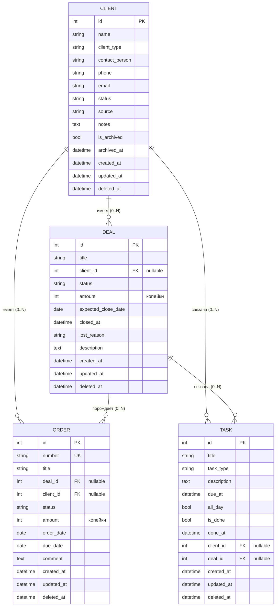

# Техническое задание: мини-CRM (MVP)

| Параметр | Значение |
|---|---|
| Документ | Техническое задание на разработку MVP мини-CRM |
| Версия | 1.1 (допущения согласованы с заказчиком для MVP) |
| Дата | 17.10.2026 |
| Стек | Python 3.12, FastAPI, SQLite, SQLAlchemy 2.x, Alembic, Jinja2 + HTMX, Google OAuth 2.0, Google Drive API v3, Google Sheets API v4, Google Picker API |

### Лист изменений

| Версия | Дата | Изменения |
|---|---|---|
| 1.0 | 17.10.2026 | Первая редакция для согласования |
| 1.1 | 17.10.2026 | Экспорт переделан по требованию заказчика: каждая выгрузка — отдельный файл Google Sheets в папке пользователя в «Моём диске». Файл создаётся через Drive API `files.create` с mimeType spreadsheet и `parents=[folder_id]`, данные записываются через Sheets API, ссылка на файл возвращается в UI. Авторизация — только OAuth 2.0 от имени пользователя: кнопка «Подключить Google», зашифрованный refresh token, отключение и переподключение, обработка `invalid_grant`, рекомендация по статусу «In production». Scope `drive.file`: папку «CRM Экспорт» создаёт приложение, другую можно выбрать через Google Picker. Режимы «лист в общей таблице» и «сервисный аккаунт» удалены. Ограничения сверены с документацией Google. Обновлены разделы 1.2, 1.3, 4.12 (новые служебные таблицы), 7, 8.2, 8.4, 9.3, 9.4, 11, 12, 13 (оценка 25 → 28 чд), 14, 15 (все допущения согласованы), 16 (вопросы на следующие версии) |

Условные обозначения: **[Д]** — допущение исполнителя; все допущения согласованы с заказчиком для MVP (сводка — раздел 15, вопросы на следующие версии — раздел 16). **MUST** — обязательно для MVP, **SHOULD** — желательно, делается при наличии времени в рамках оценки.

---

## 1. Цель и границы MVP

### 1.1. Цель

Дать небольшой команде (в MVP — одному пользователю) простой браузерный инструмент для учёта клиентов, сделок, заказов и задач взаимодействия с быстрым поиском и выгрузкой любой таблицы в Google Sheets. Критерий успеха: пользователь ведёт всю работу с клиентами в системе без обучения, а отчёты делает в Google Sheets через экспорт.

### 1.2. Что входит в MVP

1. Клиенты: создание, просмотр, редактирование, архивирование/разархивирование, удаление (мягкое), статус клиента.
2. Сделки: создание, редактирование, смена статуса, прикрепление/открепление клиента, удаление (мягкое). Сделка может существовать без клиента.
3. Заказы: отдельная простая сущность, связанная со сделкой и/или клиентом (обоснование — п. 4.1).
4. Задачи и напоминания: создание, редактирование, отметка «выполнена / не выполнена», связь с клиентом и/или сделкой, срок с датой и временем, списки «Просрочено», «Сегодня», «Предстоящие».
5. Поиск по клиентам и сделкам (глобальный и в списках), фильтры, сортировка, пагинация.
6. Экспорт любой табличной страницы UI в Google Sheets с учётом текущих фильтров и сортировки: каждая выгрузка — отдельный файл в папке пользователя на его Google Drive (OAuth-подключение аккаунта в настройках).
7. Браузерный UI (серверный рендеринг Jinja2 + HTMX).
8. Простая авторизация одного пользователя.
9. REST API (JSON) для всех операций, OpenAPI-документация.
10. Docker-развёртывание, миграции Alembic, резервное копирование SQLite, логирование.

### 1.3. Что НЕ входит в MVP

- Многопользовательский режим, роли, права доступа, назначение ответственных.
- Воронки продаж с настраиваемыми этапами, канбан-доска сделок (SHOULD на следующий этап).
- Редактируемые из UI справочники статусов (в MVP статусы фиксированы в коде).
- Позиции заказа (товары, количество, цены), склад, счета, оплаты, документы.
- Push/email/Telegram-уведомления о напоминаниях; повторяющиеся задачи.
- Интеграции с почтой, телефонией, мессенджерами, календарями.
- Импорт данных (в т. ч. из Google Sheets), двусторонняя синхронизация с Google Sheets, автоматическая регулярная выгрузка, дозапись в существующие таблицы, выгрузка на общие диски Workspace и через сервисный аккаунт.
- История изменений (аудит-лог полей), комментарии, вложения/файлы.
- Мультивалютность, аналитика и дашборды с графиками.
- Мобильное приложение (UI должен корректно открываться на планшете; телефон — не целевой).
- Корзина с восстановлением удалённых записей через UI.

---

## 2. Роли и пользователи

**[Д-1, согласовано] В MVP один пользователь — «Администратор»** с полным доступом ко всем данным и функциям.

- Учётные данные задаются переменными окружения: `ADMIN_USERNAME`, `ADMIN_PASSWORD_HASH` (bcrypt).
- Вход по форме логин/пароль, сессия — подписанная cookie (`HttpOnly`, `Secure`, `SameSite=Lax`), время жизни `SESSION_TTL_HOURS` (по умолчанию 12).
- Все страницы и эндпоинты API, кроме `/login`, `/health`, требуют авторизации; неавторизованный запрос UI — редирект на `/login`, API — `401`.
- Защита от перебора: не более 5 неудачных попыток входа за 5 минут с одного IP, далее `429` на 5 минут.
- В моделях данных поля `created_by`/`owner_id` не вводятся; при переходе к нескольким пользователям добавляются миграцией.

---

## 3. Глоссарий

| Термин | Определение |
|---|---|
| Клиент | Физическое лицо или компания, с которой ведётся работа |
| Сделка | Потенциальная или текущая продажа/проект; имеет статус и сумму |
| Заказ | Зафиксированное обязательство на поставку/выполнение работ; обычно появляется по выигранной сделке |
| Задача | Действие, которое нужно выполнить (звонок, встреча, письмо и т. п.); может иметь срок |
| Напоминание | Задача со сроком (датой и временем); отображается в блоках «Просрочено / Сегодня / Предстоящие» |
| Архив | Обратимое скрытие клиента из рабочих списков без потери данных |
| Удаление | Мягкое удаление: запись помечается `deleted_at` и исчезает из UI и API; физически остаётся в БД |

---

## 4. Модель данных

### 4.1. Решение по сущности «Заказ»

**[Д-2, согласовано] Заказ — отдельная простая сущность `Order`**, а не этап сделки. Обоснование:

- Сделка описывает процесс продажи (вероятность, этапы, проигрыш), заказ — результат и его исполнение (подтверждён, выполняется, выполнен, отменён). Это разные жизненные циклы и разные перечни статусов; смешение в одно поле статуса делает его перегруженным.
- По одной сделке возможно несколько заказов (поэтапная поставка, повторные заказы).
- Возможен заказ без сделки (повторный заказ постоянного клиента) — требование «сделки и заказы» как двух понятий.
- Отдельная таблица заказов естественно ложится в отдельную вкладку UI и отдельный экспорт в Google Sheets.

Заказ в MVP — «шапка» без позиций: номер, название, сумма, статус, даты, связи.

### 4.2. Общие правила

- Первичные ключи — `INTEGER` автоинкремент.
- Все даты-время хранятся в UTC (`DATETIME`, ISO 8601), отображаются в часовом поясе `APP_TIMEZONE` (по умолчанию `Europe/Moscow`). Поля «дата» без времени — `DATE`.
- Денежные суммы хранятся в `INTEGER` в копейках (минимальных единицах), в API передаются как десятичная строка/число с 2 знаками (`Decimal`). **[Д-3]** Одна валюта — `APP_CURRENCY` (по умолчанию `RUB`); поле валюты в MVP не вводится.
- Служебные поля у всех сущностей: `created_at`, `updated_at` (обновляется автоматически), `deleted_at` (NULL — запись активна).
- Статусы хранятся как строковые коды (`VARCHAR`) с проверкой через Python `Enum` + `CHECK`-ограничение; русские подписи — в коде UI.
- SQLite запускается с `PRAGMA foreign_keys=ON`, `PRAGMA journal_mode=WAL`.
- Поле `search_text` (служебное, у Client и Deal) — нормализованная (casefold, `ё`→`е`, телефон — только цифры) склейка полей поиска; пересчитывается приложением при каждом сохранении. Причина: встроенные `LIKE`/`lower()` SQLite нечувствительны к регистру только для ASCII и не работают корректно с кириллицей.

### 4.3. Сущность Client (клиент)

| Поле | Тип | Обяз. | Описание / ограничения |
|---|---|---|---|
| id | INTEGER PK | да | |
| name | VARCHAR(200) | да | ФИО или название компании; 1–200 символов после trim |
| client_type | VARCHAR(16) | да | `person` (физ. лицо) / `company` (компания); по умолчанию `company` |
| contact_person | VARCHAR(200) | нет | Контактное лицо (для компании) |
| phone | VARCHAR(32) | нет | Свободный формат; допустимы цифры, пробел, `+ - ( )` |
| email | VARCHAR(254) | нет | Валидация формата email |
| status | VARCHAR(16) | да | См. 4.7.1; по умолчанию `lead` |
| source | VARCHAR(100) | нет | Источник клиента (свободный текст) |
| notes | TEXT | нет | До 5000 символов |
| is_archived | BOOLEAN | да | По умолчанию `false` |
| archived_at | DATETIME | нет | Заполняется при архивировании |
| search_text | TEXT | да | Служебное, индексируется |
| created_at, updated_at | DATETIME | да | |
| deleted_at | DATETIME | нет | Мягкое удаление |

Дубликаты: при совпадении `email` или цифр `phone` с существующим активным клиентом UI показывает предупреждение со ссылкой на найденного клиента, но сохранение не блокирует.

### 4.4. Сущность Deal (сделка)

| Поле | Тип | Обяз. | Описание / ограничения |
|---|---|---|---|
| id | INTEGER PK | да | |
| title | VARCHAR(200) | да | Название сделки |
| client_id | INTEGER FK → clients.id | нет | NULL — сделка без клиента |
| status | VARCHAR(16) | да | См. 4.7.2; по умолчанию `new` |
| amount | INTEGER (копейки) | нет | ≥ 0 |
| expected_close_date | DATE | нет | Плановая дата закрытия |
| closed_at | DATETIME | нет | Устанавливается автоматически при переходе в `won`/`lost`, сбрасывается при возврате в открытый статус |
| lost_reason | VARCHAR(500) | нет | Причина проигрыша; предлагается к заполнению при статусе `lost` |
| description | TEXT | нет | До 5000 символов |
| search_text | TEXT | да | Служебное (title, description, имя клиента) |
| created_at, updated_at, deleted_at | DATETIME | | |

### 4.5. Сущность Order (заказ)

| Поле | Тип | Обяз. | Описание / ограничения |
|---|---|---|---|
| id | INTEGER PK | да | |
| number | VARCHAR(20) UNIQUE | да | Генерируется автоматически: `ORD-000001` |
| title | VARCHAR(200) | да | Краткое описание заказа |
| deal_id | INTEGER FK → deals.id | нет | Сделка-основание |
| client_id | INTEGER FK → clients.id | нет | Клиент; при выборе сделки с клиентом подставляется автоматически (можно изменить) |
| status | VARCHAR(16) | да | См. 4.7.3; по умолчанию `new` |
| amount | INTEGER (копейки) | нет | ≥ 0; при создании из сделки по умолчанию = сумме сделки |
| order_date | DATE | да | По умолчанию — текущая дата |
| due_date | DATE | нет | Плановая дата исполнения |
| comment | TEXT | нет | До 5000 символов |
| created_at, updated_at, deleted_at | DATETIME | | |

**[Д-4]** Заказ может не иметь ни сделки, ни клиента (по аналогии со сделкой). Рекомендуется предупреждение в UI, если обе связи пусты.

### 4.6. Сущность Task (задача / напоминание)

| Поле | Тип | Обяз. | Описание / ограничения |
|---|---|---|---|
| id | INTEGER PK | да | |
| title | VARCHAR(200) | да | Что сделать |
| task_type | VARCHAR(16) | да | `call` звонок, `meeting` встреча, `email` письмо, `todo` дело, `other` прочее; по умолчанию `todo` |
| description | TEXT | нет | До 5000 символов |
| due_at | DATETIME | нет | Срок (дата и время). Если задано — задача является напоминанием. Допускается ввод только даты: тогда время = 23:59 локального времени и флаг `all_day=true` |
| all_day | BOOLEAN | да | По умолчанию `false` |
| is_done | BOOLEAN | да | По умолчанию `false` |
| done_at | DATETIME | нет | Ставится при отметке «выполнена», сбрасывается при снятии отметки |
| client_id | INTEGER FK → clients.id | нет | Связанный клиент |
| deal_id | INTEGER FK → deals.id | нет | Связанная сделка |
| created_at, updated_at, deleted_at | DATETIME | | |

Правила связей задачи: допускаются варианты «без связи», «только клиент», «только сделка», «клиент и сделка». Если указана только сделка, у которой есть клиент, задача отображается и в карточке этого клиента (через сделку); `client_id` при этом не дублируется автоматически.

Вычисляемое состояние (в БД не хранится): `overdue` — `is_done=false` и `due_at < now`; `today` — `is_done=false` и `due_at` в пределах текущих локальных суток; `upcoming` — `due_at` позже сегодняшнего дня; `no_due` — `due_at` пуст.

### 4.7. Перечни статусов

**[Д-5]** Статусы фиксированы в коде; переходы между любыми статусами разрешены (жёсткой машины состояний в MVP нет).

#### 4.7.1. Статус клиента (`Client.status`)

| Код | Подпись | Смысл |
|---|---|---|
| lead | Потенциальный | Контакт есть, покупок ещё нет |
| active | Активный | Есть текущие сделки/заказы или регулярная работа |
| inactive | Неактивный | Работа приостановлена |
| lost | Потерян | Отказался от работы |

Архив — отдельный флаг `is_archived`, не статус: клиент в архиве сохраняет свой последний статус.

#### 4.7.2. Статус сделки (`Deal.status`)

| Код | Подпись | Группа |
|---|---|---|
| new | Новая | открытая |
| in_progress | В работе | открытая |
| proposal | КП отправлено | открытая |
| negotiation | Переговоры | открытая |
| won | Успешно закрыта | закрытая |
| lost | Проиграна | закрытая |

#### 4.7.3. Статус заказа (`Order.status`)

| Код | Подпись | Группа |
|---|---|---|
| new | Новый | открытый |
| confirmed | Подтверждён | открытый |
| in_progress | В исполнении | открытый |
| completed | Выполнен | закрытый |
| cancelled | Отменён | закрытый |

#### 4.7.4. Статус задачи

Хранится булевым `is_done`: «Не выполнена» / «Выполнена». В UI дополнительно выводится вычисляемая метка срока: «Просрочена», «Сегодня», «Предстоит», «Без срока».

### 4.8. Связи

| Связь | Кардинальность | FK | При удалении родителя (мягком) |
|---|---|---|---|
| Client → Deal | 1 : 0..N | deals.client_id, NULL допустим | Сделки сохраняются, ссылка остаётся; в UI клиент показывается как «Клиент удалён» без ссылки |
| Client → Order | 1 : 0..N | orders.client_id | Аналогично сделкам |
| Client → Task | 1 : 0..N | tasks.client_id | Связанные задачи мягко удаляются вместе с клиентом |
| Deal → Order | 1 : 0..N | orders.deal_id | Заказы сохраняются, в UI «Сделка удалена» |
| Deal → Task | 1 : 0..N | tasks.deal_id | Связанные задачи мягко удаляются вместе со сделкой |

На уровне БД у всех FK `ON DELETE SET NULL` (на случай будущей физической очистки); в работе приложения физическое удаление не используется.

### 4.9. Архивирование и удаление

| Операция | Клиент | Сделка | Заказ | Задача |
|---|---|---|---|---|
| Архивировать / разархивировать | да | нет | нет | нет |
| Удалить (мягко) | да | да | да | да |
| Восстановить из удалённых через UI | нет (вне MVP) | нет | нет | нет |

**Архивирование клиента** (рекомендуемое действие вместо удаления):

- Клиент скрывается из списка клиентов по умолчанию, доступен через фильтр «Архив» / «Все», карточка открывается по прямой ссылке и в результатах поиска с пометкой «В архиве».
- Связанные сделки, заказы и задачи не изменяются и остаются в своих списках с пометкой клиента «(архив)».
- Архивного клиента нельзя выбрать при прикреплении к новой сделке/заказу/задаче (в выпадающем поиске не показывается); существующие связи сохраняются.
- Если у клиента есть невыполненные задачи или открытые сделки, при архивировании показывается предупреждение с их количеством; архивирование не блокируется.
- Разархивирование возвращает клиента в рабочие списки без других изменений.

**Удаление** (мягкое, `deleted_at = now`):

- Перед удалением показывается диалог подтверждения с количеством связанных объектов и последствиями (что будет удалено вместе с объектом, что останется).
- Удалённая запись не возвращается ни в одном списке, поиске и экспорте; запрос по id возвращает `404`.
- Каскад — согласно таблице 4.8 (задачи удаляются вместе с родителем, сделки и заказы — сохраняются).
- Физическое удаление и восстановление — только администратором БД вне UI (вне MVP).

### 4.10. ER-диаграмма



### 4.11. Индексы

- `clients`: `(deleted_at, is_archived, status)`, `search_text`, `updated_at`.
- `deals`: `(deleted_at, status)`, `client_id`, `search_text`, `updated_at`.
- `orders`: `UNIQUE(number)`, `deal_id`, `client_id`, `(deleted_at, status)`.
- `tasks`: `(deleted_at, is_done, due_at)`, `client_id`, `deal_id`.

### 4.12. Служебные таблицы (экспорт)

На ER-диаграмме они не показаны, так как не связаны с бизнес-сущностями.

| Таблица | Поля | Назначение |
|---|---|---|
| app_settings | key VARCHAR(64) PK, value TEXT, updated_at | Настройки, изменяемые из UI. В MVP — `google_drive_folder_id`, `google_drive_folder_name` |
| google_oauth_credentials | id PK (всегда одна запись), account_email, scopes, refresh_token_encrypted BLOB, status (`active`/`reauth_required`), connected_at, last_refresh_at, last_error, last_error_at | Подключённый Google-аккаунт (п. 7.3). Токен хранится только в зашифрованном виде |
| export_log | id PK, entity, file_id, file_name, file_url, folder_id, rows, status (`success`/`failed`), error_code, filters JSON, duration_ms, created_at | Журнал выгрузок для страницы «Настройки»; хранятся последние 1000 записей |

---

## 5. Функциональные требования

Формат: ID требования, пользовательский сценарий, критерии приёмки (КП). Все КП проверяются и через UI, и через API.

### 5.1. Модуль «Клиенты»

| ID | Требование |
|---|---|
| CL-1 | Просмотр списка клиентов с поиском, фильтрами, сортировкой, пагинацией (раздел 6) |
| CL-2 | Создание клиента |
| CL-3 | Просмотр карточки клиента со связанными сделками, заказами, задачами |
| CL-4 | Редактирование клиента, в т. ч. быстрая смена статуса |
| CL-5 | Архивирование и разархивирование |
| CL-6 | Мягкое удаление |
| CL-7 | Экспорт списка в Google Sheets (раздел 7) |

**Сценарий CL-2. Создание клиента.** Пользователь на странице «Клиенты» нажимает «+ Клиент», заполняет форму (обязательно только «Имя/название»), нажимает «Сохранить».
КП:
- Без имени форма не сохраняется, у поля выводится сообщение «Обязательное поле».
- Некорректный email отклоняется с сообщением у поля; введённые данные не теряются.
- После сохранения открывается карточка клиента, вверху уведомление «Клиент создан»; статус по умолчанию «Потенциальный».
- При совпадении email/телефона с существующим клиентом показывается предупреждение со ссылкой, сохранение возможно.

**Сценарий CL-3. Карточка клиента.** Пользователь кликает по строке клиента.
КП:
- Отображаются все поля клиента, статус, признак архива.
- Блоки «Сделки», «Заказы», «Задачи» показывают связанные неудалённые записи; задачи сортируются: просроченные → сегодня → предстоящие → без срока → выполненные (выполненные свёрнуты).
- Из карточки можно: создать сделку, заказ, задачу с уже подставленным клиентом; отметить задачу выполненной; перейти в любую связанную запись.

**Сценарий CL-4. Редактирование.** КП: изменения сохраняются, `updated_at` обновляется; смена статуса доступна выпадающим списком прямо в карточке и в строке списка без открытия формы (HTMX, без перезагрузки страницы).

**Сценарий CL-5. Архивирование.** КП: соответствует п. 4.9; после архивирования клиент пропадает из списка с фильтром по умолчанию и виден при фильтре «Архив»; кнопка «Вернуть из архива» восстанавливает его.

**Сценарий CL-6. Удаление.** КП: диалог «Удалить клиента «X»? Будут удалены N задач. M сделок и K заказов останутся без ссылки на клиента.»; после подтверждения клиент недоступен в UI/API/поиске/экспорте, связанные задачи удалены, сделки и заказы остались.

### 5.2. Модуль «Сделки»

| ID | Требование |
|---|---|
| DL-1 | Список сделок с поиском, фильтрами (статус, группа открытые/закрытые, клиент, «без клиента», диапазон суммы, плановая дата), сортировкой, пагинацией |
| DL-2 | Создание сделки с клиентом или без |
| DL-3 | Карточка сделки: поля, клиент, связанные заказы и задачи |
| DL-4 | Редактирование сделки |
| DL-5 | Смена статуса (в списке и карточке) |
| DL-6 | Прикрепление клиента к сделке и открепление |
| DL-7 | Мягкое удаление |
| DL-8 | Создание заказа из сделки |
| DL-9 | Экспорт списка в Google Sheets |

**Сценарий DL-2. Создание.** Пользователь нажимает «+ Сделка», вводит название, при желании выбирает клиента через поле с автодополнением (поиск по имени/телефону/email, от 2 символов, до 10 вариантов), сумму, плановую дату.
КП: сделка без клиента сохраняется; в автодополнении нет архивных и удалённых клиентов; статус по умолчанию «Новая».

**Сценарий DL-5. Смена статуса.** КП:
- При переходе в «Успешно закрыта»/«Проиграна» автоматически заполняется `closed_at`; при возврате в открытый статус — очищается.
- При выборе «Проиграна» предлагается (необязательно) указать причину.
- При переходе в «Успешно закрыта» показывается ненавязчивое предложение «Создать заказ по сделке?».
- **[Д-6]** Статус клиента автоматически не меняется (никаких скрытых побочных эффектов в MVP).

**Сценарий DL-6. Прикрепление/открепление клиента.** В карточке сделки в блоке «Клиент»: если клиента нет — кнопка «Прикрепить клиента» (автодополнение + ссылка «Создать нового клиента», после создания он сразу прикрепляется); если есть — «Сменить» и «Открепить».
КП:
- После прикрепления сделка появляется в карточке клиента; после открепления — пропадает, у сделки `client_id = NULL`.
- Открепление не меняет `client_id` у заказов и задач сделки (они сохраняют свои связи); в диалоге открепления это сообщается.
- Операции доступны отдельными эндпоинтами API (раздел 8).

**Сценарий DL-7. Удаление.** КП: диалог с количеством связанных задач (будут удалены) и заказов (останутся с пометкой «Сделка удалена»).

### 5.3. Модуль «Заказы»

| ID | Требование |
|---|---|
| OR-1 | Список заказов: поиск по номеру/названию/клиенту, фильтры (статус, клиент, сделка, период `order_date`), сортировка, пагинация |
| OR-2 | Создание заказа (из списка, из карточки сделки, из карточки клиента) |
| OR-3 | Карточка и редактирование заказа, смена статуса |
| OR-4 | Мягкое удаление |
| OR-5 | Экспорт списка в Google Sheets |

КП:
- Номер `ORD-NNNNNN` генерируется автоматически, уникален и не переиспользуется после удаления.
- При создании из сделки подставляются сделка, её клиент и сумма; все значения редактируемы.
- При выборе сделки в форме, если поле клиента пустое, подставляется клиент сделки.
- Заказ отображается в карточке связанной сделки и связанного клиента.

### 5.4. Модуль «Задачи и напоминания»

| ID | Требование |
|---|---|
| TS-1 | Создание задачи/напоминания (из раздела «Задачи», из карточки клиента/сделки, быстрым вводом) |
| TS-2 | Отметка «выполнена» / снятие отметки одним кликом (чекбокс) |
| TS-3 | Редактирование, перенос срока, мягкое удаление |
| TS-4 | Список задач с группировкой по сроку и фильтрами |
| TS-5 | Отображение напоминаний (раздел 10) |
| TS-6 | Экспорт списка в Google Sheets |

**Сценарий TS-1. Быстрое создание.** Вверху страницы «Задачи» и в карточках клиента/сделки — строка быстрого ввода: название + дата/время (необязательно) + кнопка «Добавить». Полная форма — по ссылке «Подробнее».
КП:
- Задача без срока, без клиента и без сделки сохраняется.
- Срок в прошлом допускается (предупреждение «Срок уже прошёл»).
- При создании из карточки клиента/сделки связь подставляется автоматически.
- Выбор сделки в форме ограничен неудалёнными сделками; клиента — неархивными и неудалёнными.

**Сценарий TS-2. Отметка выполнения.** КП: клик по чекбоксу без перезагрузки страницы ставит `is_done=true`, `done_at=now`, задача визуально перечёркивается и перемещается в «Выполненные»; повторный клик возвращает `is_done=false`, `done_at=NULL`. Действие обратимо, подтверждение не требуется.

**Сценарий TS-3. Перенос срока.** В строке задачи — быстрые кнопки «+1 час», «Завтра», «+1 неделя» и выбор даты. КП: срок обновляется, задача перемещается в нужную группу.

**Сценарий TS-4. Список.** Вкладки: «Активные» (по умолчанию: просроченные → сегодня → предстоящие → без срока), «Выполненные», «Все». Фильтры: тип, клиент, сделка, период срока. Поиск по названию и описанию.

---

## 6. Поиск, фильтры, сортировка, пагинация

### 6.1. Глобальный поиск

- Поле поиска в шапке на всех страницах, горячая клавиша `/`.
- Поиск по клиентам и сделкам одновременно; результаты — выпадающий список по мере ввода (от 2 символов, задержка 300 мс, до 5 клиентов и 5 сделок) и страница полных результатов `/search?q=` по Enter.
- Совпадение подсвечивается, у архивных клиентов — пометка «В архиве». Удалённые записи не ищутся никогда.

### 6.2. Поля поиска

| Сущность | Поля |
|---|---|
| Клиент | name, contact_person, email, phone (по цифрам: «+7 (999) 123» находит «89991234567» по подстроке цифр «999123»), source, notes |
| Сделка | title, description, имя привязанного клиента |
| Заказ (в своём списке) | number, title, имя клиента |
| Задача (в своём списке) | title, description |

Алгоритм: запрос нормализуется так же, как `search_text` (casefold, `ё`→`е`, обрезка пробелов), разбивается на слова; запись найдена, если **каждое** слово входит подстрокой в `search_text` (`LIKE '%слово%'`). Для объёмов MVP (до 10–50 тыс. записей) этого достаточно; FTS5 — при росте объёмов (вне MVP). При изменении имени клиента `search_text` его сделок пересчитывается.

### 6.3. Фильтры

| Список | Фильтры |
|---|---|
| Клиенты | статус (множественный выбор); архив: «Активные» (по умолчанию) / «Архив» / «Все»; тип клиента; дата создания (с–по) |
| Сделки | статус (множественный); группа: открытые (по умолчанию) / закрытые / все; клиент; «без клиента»; сумма от–до; плановая дата закрытия с–по |
| Заказы | статус; клиент; сделка; дата заказа с–по |
| Задачи | вкладка выполнения; тип; клиент; сделка; срок с–по; «только просроченные» |

Фильтры, сортировка, поиск и номер страницы отражаются в query-параметрах URL (ссылку можно сохранить в закладки, кнопка «Назад» работает). Кнопка «Сбросить фильтры».

### 6.4. Сортировка

- По клику на заголовок колонки; повторный клик меняет направление; разрешённые поля — белый список.
- Клиенты: name, status, created_at, updated_at (по умолчанию `updated_at desc`).
- Сделки: title, status, amount, expected_close_date, created_at, updated_at (по умолчанию `updated_at desc`).
- Заказы: number, order_date, due_date, amount, status (по умолчанию `order_date desc`).
- Задачи: due_at (по умолчанию `asc`, пустые — в конце), created_at, title.
- Сортировка по имени — с учётом кириллицы (кастомная collation `NOCASE_RU`, регистрируемая в SQLite-подключении приложения).

### 6.5. Пагинация

- Постраничная: параметры `page` (с 1) и `page_size` (по умолчанию 25, допустимо 10/25/50/100, максимум 100).
- Ответ API содержит `items`, `total`, `page`, `page_size`, `pages`.
- В UI: «Показано 26–50 из 312», переключатель страниц и размера страницы.

---

## 7. Экспорт в Google Sheets

### 7.1. Принцип (согласовано с заказчиком)

**[Д-7, согласовано] Каждая выгрузка создаёт отдельный файл Google Sheets в папке пользователя на его Google Drive («Мой диск»).** Авторизация — только OAuth 2.0 от имени этого пользователя. Режимы «новый лист в общей таблице» и «сервисный аккаунт / общий диск» исключены. Существующие файлы приложение не изменяет и не перезаписывает, поэтому старые выгрузки сохраняются.

- Google-аккаунт подключается один раз кнопкой «Подключить Google» на странице «Настройки». После этого кнопка экспорта работает без повторного входа в Google.
- Файлы создаются от имени подключённого аккаунта и в его квоте хранилища. Этот аккаунт — их владелец.
- Папка выгрузок задаётся на странице «Настройки» (п. 7.4): по умолчанию это папка «CRM Экспорт», которую приложение создаёт само; другую папку можно выбрать через Google Picker или указать ссылкой/ID.
- Имя файла: `<Сущность> — ГГГГ-ММ-ДД ЧЧ-ММ` по `APP_TIMEZONE`, например `Клиенты — 2026-10-17 21-45`. Сущности: «Клиенты», «Сделки», «Заказы», «Задачи», «Поиск»; для таблиц из карточек — с уточнением, например `Сделки клиента «ООО Ромашка» — 2026-10-17 21-45`. Drive допускает одинаковые имена, а каждый файл однозначно определяется своим ID, поэтому две выгрузки в одну минуту конфликта не создают. Шаблон имени можно переопределить через `EXPORT_FILE_NAME_TEMPLATE`.

### 7.2. Ограничения Google (проверено по документации Google, актуальность на 17.10.2026)

| Факт | Источник | Следствие для ТЗ |
|---|---|---|
| У сервисных аккаунтов нет квоты хранилища, и они не могут владеть файлами. Файлы нужно создавать на общих дисках или через OAuth 2.0 от имени пользователя | developers.google.com/workspace/drive/api/guides/about-shareddrives; handle-errors, раздел `storageQuotaExceeded` | Создать файл в «Моём диске» пользователя сервисный аккаунт не может (`403 storageQuotaExceeded`), поэтому используется только OAuth от имени пользователя |
| `drive.file` — несекретный (non-sensitive) scope, рекомендованный Google. Он даёт доступ только к файлам, которые приложение создало само или которые пользователь открыл/выбрал через Google Picker. `drive` — ограниченный (restricted) scope с полным доступом к Диску. Для публичного приложения он требует верификации по ограниченным scope'ам, а при хранении или передаче данных через сервер — ещё и security assessment | developers.google.com/workspace/drive/api/guides/api-specific-auth | С `drive.file` папка, созданная пользователем вручную, приложению не видна (`404 notFound`), пока пользователь не выберет её в Picker. Решение — п. 7.3 |
| Sheets API принимает `drive.file` (рекомендуемый, несекретный), `drive`, а также `spreadsheets` (чувствительный, sensitive) | developers.google.com/workspace/sheets/api/scopes | Отдельный scope `spreadsheets` не нужен: файлы создаёт само приложение, поэтому `drive.file` покрывает запись в них через Sheets API |
| Google Picker для веб-приложений поддерживает `drive.file`, принимает access token через `setOAuthToken` и позволяет ограничить выбор папками | developers.google.com/workspace/drive/picker/guides/overview | Выбор существующей папки пользователя — через Picker, без расширения scope |
| OAuth-клиент с типом пользователей External и статусом публикации «Testing» получает refresh token со сроком 7 дней, если запрошено что-либо кроме `openid`/`email`/`profile` | developers.google.com/identity/protocols/oauth2, «Refresh token expiration» | В статусе «Testing» экспорт перестанет работать через неделю после подключения. Рекомендация — п. 7.3.1 |
| Refresh token перестаёт работать в следующих случаях: пользователь отозвал доступ; токен не использовался 6 месяцев; превышен лимит в 100 refresh token на аккаунт и клиент (самый старый тогда аннулируется без предупреждения); администратор Workspace ограничил сервис (`admin_policy_enforced`). Приложение обязано быть готово к неработающему токену | identity/protocols/oauth2 | Обработка `invalid_grant`, еженедельная проверка токена, хранение одного токена (п. 7.3.3) |
| Refresh token нужно хранить в защищённом долговременном хранилище | api-specific-auth, «Securely store refresh tokens» | Токен шифруется в БД (п. 7.3.3) |

### 7.3. Авторизация OAuth 2.0

#### 7.3.1. Настройка Google Cloud (один раз; инструкция в README и на странице «Настройки»)

1. Создать проект в Google Cloud Console и включить **Google Drive API**, **Google Sheets API** и **Google Picker API**.
2. Настроить OAuth consent screen (Google Auth Platform):
   - название приложения, email поддержки;
   - scopes: `openid`, `.../auth/userinfo.email`, `.../auth/drive.file`.
3. Выбрать тип пользователей и статус публикации:
   - если аккаунт пользователя в Google Workspace — тип **Internal**: 7-дневного ограничения нет;
   - иначе (в том числе `@gmail.com`) — тип **External**, и **обязательно перевести приложение в статус «In production»** (Publish app). Все запрашиваемые scope'ы несекретные, поэтому верификация по sensitive/restricted scope'ам не требуется.
   - Статус **«Testing» допустим только для разработки**: refresh token истекает через 7 дней, и экспорт потребует переподключения.
   - Приложение показывает предупреждение на странице «Настройки», если подключение повторно ломается примерно через 7 дней (эвристика: два `invalid_grant` с интервалом около 7 дней).
4. Создать OAuth Client ID типа **Web application**:
   - Authorized redirect URI: `{APP_BASE_URL}/settings/google/oauth/callback` (Google требует HTTPS, кроме `localhost`);
   - Authorized JavaScript origin: `{APP_BASE_URL}` (нужен для Picker).
5. Создать API key, ограниченный Google Picker API и HTTP-referrer `{APP_BASE_URL}/*`. Номер проекта (Project number) нужен Picker как `appId`.
6. Задать переменные окружения (п. 7.8) и перезапустить контейнер.

#### 7.3.2. Выбор scope и папки — решение

**Решение: scope `drive.file` (+ `openid email`); папку по умолчанию приложение создаёт само; выбор другой существующей папки — через Google Picker.**

| Вариант | Оценка | Решение |
|---|---|---|
| `drive.file`, приложение само создаёт папку «CRM Экспорт» | Минимальные права, несекретный scope, нет верификации и экрана «Приложение не проверено». Пользователь может переименовать папку или переместить её внутри «Моего диска», доступ сохраняется | **Основной вариант** — выполняется автоматически при первом подключении |
| `drive.file` + Google Picker для выбора существующей папки | Выбор в Picker даёт приложению доступ к выбранной папке без расширения прав. Небольшой объём клиентского JS, нужны API key и номер проекта | **Входит в MVP** — кнопка «Выбрать другую папку» |
| Ввод ссылки/ID произвольной папки при `drive.file` | Работает, только если папка создана приложением или ранее выбрана в Picker; для папки, созданной вручную, Drive вернёт `404` | Поле поддерживается. При `404` UI предлагает выбрать эту же папку через Picker |
| Scope `drive` (полный доступ к Диску) | Ограниченный scope. Для приложения в статусе «In production» без верификации Google показывает экран «Приложение не проверено» и ограничивает число пользователей. Полная верификация с security assessment несоразмерна MVP. Избыточные права: доступ ко всему Диску пользователя | **Отклонён** |

#### 7.3.3. Подключение, хранение токена, отключение

**Подключение** («Настройки» → «Подключить Google»):

1. Используется Authorization Code flow для веб-сервера с параметрами `access_type=offline`, `prompt=consent`, `include_granted_scopes=true`, одноразовым `state` (привязан к сессии, живёт 10 минут) и PKCE (S256).
2. Callback `/settings/google/oauth/callback` проверяет `state`, обменивает код на токены и проверяет, что в выданных scope'ах есть `drive.file`. Если пользователь снял галочку доступа к Drive, выводится ошибка «Не выдан доступ к Google Drive» и предложение повторить.
3. Приложение сохраняет refresh token (зашифрованным) и email аккаунта.
4. Если папка ещё не задана, приложение создаёт папку «CRM Экспорт» в корне «Моего диска» (`files.create`, `mimeType=application/vnd.google-apps.folder`) и сохраняет её ID в настройках.
5. Пользователь возвращается в «Настройки» с сообщением «Google-аккаунт <email> подключён. Папка выгрузок: CRM Экспорт».

**Резервный способ для сервера без публичного HTTPS-адреса:** CLI `python -m app.cli google-auth`. Нужен OAuth Client типа Desktop app (`GOOGLE_OAUTH_CLIENT_FILE`). Скрипт поднимает loopback-сервер `127.0.0.1:8765`; к удалённому серверу подключаются через `ssh -L 8765:127.0.0.1:8765`. Результат (токен, email, папка) сохраняется так же, как при подключении через UI. Google Picker без HTTPS-адреса недоступен; тогда используется папка «CRM Экспорт».

**Хранение токена:**

- Одна запись в таблице `google_oauth_credentials` (п. 4.12).
- Refresh token зашифрован Fernet (AES-128-CBC + HMAC-SHA256); ключ — `GOOGLE_TOKEN_ENCRYPTION_KEY`, хранится вне БД. Без ключа утечка файла БД или бэкапа не раскрывает токен.
- Access token (около 1 часа) хранится только в памяти процесса и обновляется по refresh token по мере необходимости.
- Токены не выводятся в UI, логи и ответы API.
- Повторное подключение заменяет старый токен: старый перед этим отзывается, чтобы не копить токены и не упереться в лимит в 100 токенов.

**Проверка и истечение:**

- Фоновое задание (APScheduler) раз в 7 дней обновляет access token. Так проверяется действительность refresh token, и он не истекает из-за 6 месяцев неиспользования.
- При `invalid_grant` (отозван пользователем, истёк, превышен лимит, сменилась политика домена) — при экспорте, проверке или фоновом задании:
  - статус меняется на «Требуется переподключение», фиксируется время и причина;
  - в шапке UI появляется значок предупреждения у «Настроек»;
  - экспорт возвращает `google_reauth_required` с кнопкой «Переподключить Google»;
  - настройки (папка) сохраняются: после переподключения тем же аккаунтом экспорт сразу работает.
- Переподключение **другим** аккаунтом: приложение предупреждает, что папка выгрузок принадлежит прежнему аккаунту, и после подтверждения создаёт новую папку «CRM Экспорт» в Диске нового аккаунта.

**Отключение** («Отключить Google»):

- токен отзывается через `https://oauth2.googleapis.com/revoke` (best effort);
- запись токена удаляется, экспорт переходит в статус «Не подключено»;
- ID папки сохраняется в настройках;
- уже созданные файлы остаются в Диске пользователя.

### 7.4. Папка выгрузок

- Папка хранится в `app_settings.google_drive_folder_id`. На странице «Настройки» показываются имя папки, ссылка «Открыть в Google Drive» и ID.
- Способы задать папку:
  1. автоматически при первом подключении («CRM Экспорт»);
  2. кнопка «Выбрать другую папку» — Google Picker (`DocsView` с папками и `setSelectFolderEnabled(true)`), ID выбранной папки сохраняется;
  3. поле «Ссылка или ID папки» — ID извлекается из ссылки вида `https://drive.google.com/drive/folders/<ID>`;
  4. кнопка «Создать новую папку «CRM Экспорт»».
- Перед сохранением любая папка проверяется по п. 7.6.
- Для Picker браузер получает короткоживущий access token (`drive.file`) с эндпоинта, доступного только авторизованному администратору. Refresh token на клиент не передаётся.

### 7.5. Алгоритм выгрузки и формат файла

Выгрузка выполняется синхронно в рамках HTTP-запроса. Общий таймаут — `EXPORT_TIMEOUT_SECONDS`, по умолчанию 60 с.

1. Проверки: аккаунт подключён, папка задана, лимит строк не превышен. Выборка данных теми же фильтрами, поиском и сортировкой, что у списка, со всех страниц.
2. **Создание файла через Drive API** `files.create`:
   - тело: `name` (п. 7.1), `mimeType: "application/vnd.google-apps.spreadsheet"`, `parents: [folder_id]`, `description` (дата, фильтры, поиск, сортировка, число строк);
   - параметры: `fields=id,name,webViewLink`, `supportsAllDrives=true` (Google рекомендует для совместимости; на работу в «Моём диске» не влияет).
3. **Запись данных через Sheets API:**
   - `spreadsheets.batchUpdate`: переименовать первый лист (`sheetId=0`) в имя сущности, задать `locale=ru_RU` и `timeZone=APP_TIMEZONE`;
   - `spreadsheets.values.update`: диапазон `'<Лист>'!A1`, `valueInputOption=RAW`, заголовки и данные одним запросом (до 10 000 строк);
   - `spreadsheets.batchUpdate`: форматирование.
4. Ответ — ID, имя и `webViewLink` файла, ссылка на папку, число строк. Запись в журнал `export_log`.
5. Если ошибка возникла после шага 2, неполный файл отправляется в корзину (`files.update` с `trashed=true`; best effort).

Поведение в UI:

- Кнопка «Экспорт в Google Sheets» есть на каждой табличной странице: Клиенты, Сделки, Заказы, Задачи, Результаты поиска, а также таблицы связанных записей в карточке клиента и сделки.
- Если Google не подключён, вместо выгрузки открывается диалог «Подключите Google-аккаунт» со ссылкой на «Настройки».
- Перед запуском показывается «Будет создан файл «Клиенты — 2026-10-17 21-45» (N строк) в папке «CRM Экспорт»». При превышении `EXPORT_MAX_ROWS` (по умолчанию 10 000) — сообщение с предложением сузить фильтры.
- Во время выгрузки кнопка заблокирована и показывает индикатор.
- По успешному завершению — уведомление (не скрывается автоматически) «Создан файл «…», выгружено N строк» с кнопками «Открыть файл» (`webViewLink`, новая вкладка) и «Открыть папку».
- Последние 20 выгрузок со ссылками видны на странице «Настройки».

Формат файла:

- Один лист, названный по сущности. Строка 1 — заголовки на русском: жирные, с фоном, закреплённые (frozen row), с фильтром (basic filter) на диапазон. Ширина колонок подбирается автоматически.
- Метаданные выгрузки — в описании файла Drive и в примечании (note) к ячейке A1.
- Форматы значений:
  - даты — в `APP_TIMEZONE`, `ДД.ММ.ГГГГ` / `ДД.ММ.ГГГГ ЧЧ:ММ`;
  - суммы — числом с форматом `#,##0.00`;
  - статусы — русские подписи;
  - булевы — «Да»/«Нет»;
  - связи — имя/название и отдельной колонкой ID.
- При `RAW` значения, начинающиеся с `=`, `+`, `-`, `@`, записываются как текст: формула не может появиться из данных (formula injection).

| Сущность | Колонки (по порядку) |
|---|---|
| Клиенты | ID; Имя/название; Тип; Контактное лицо; Телефон; Email; Статус; Источник; В архиве; Открытых сделок; Невыполненных задач; Создан; Изменён; Заметки |
| Сделки | ID; Название; Клиент; ID клиента; Статус; Сумма; Плановая дата закрытия; Дата закрытия; Причина проигрыша; Создана; Изменена; Описание |
| Заказы | ID; Номер; Название; Клиент; ID клиента; Сделка; ID сделки; Статус; Сумма; Дата заказа; Плановая дата исполнения; Создан; Комментарий |
| Задачи | ID; Название; Тип; Срок; Состояние срока; Выполнена; Дата выполнения; Клиент; ID клиента; Сделка; ID сделки; Создана; Описание |
| Результаты поиска | Тип записи (Клиент/Сделка); ID; Название; Статус; Клиент (для сделки); Изменён |

### 7.6. Проверка подключения и папки

Кнопка «Проверить подключение» на странице «Настройки» (`POST /api/v1/exports/check`) и сохранение папки выполняют:

1. Получение access token по refresh token (ловится `invalid_grant`).
2. `files.get(folder_id, fields=id,name,mimeType,trashed,capabilities/canAddChildren)`. Проверяется, что:
   - объект доступен приложению;
   - это папка (`application/vnd.google-apps.folder`);
   - папка не в корзине;
   - в неё можно добавлять файлы.
3. Результат: email аккаунта, имя папки и ссылка на неё, время проверки. Пробный файл не создаётся.

### 7.7. Обработка ошибок

Ошибки Google распознаются по HTTP-коду и полю `error.errors[].reason` (или `error` OAuth-ответа). Пользователю показывается сообщение на русском с рекомендацией. В API ответ — в формате 8.4.

| Ситуация (код Google, reason) | Сообщение пользователю (суть) | Код ответа API |
|---|---|---|
| Google не подключён / не задан OAuth-клиент в окружении | «Подключите Google-аккаунт в настройках» / «Экспорт не настроен администратором» | 503 `google_not_connected` / `export_not_configured` |
| Папка не задана | «Выберите папку для выгрузок в настройках» | 503 `google_folder_not_set` |
| `invalid_grant` (токен отозван или истёк, в т. ч. 7 дней в статусе «Testing») | «Доступ к Google-аккаунту утрачен. Переподключите Google в настройках» | 502 `google_reauth_required` |
| Пользователь отказал в согласии или не выдал доступ к Drive | «Доступ к Google Drive не выдан. Повторите подключение и разрешите доступ к файлам» | редирект в «Настройки» с ошибкой |
| `401 authError` после обновления токена | Повторное обновление токена; при неудаче — как `invalid_grant` | 502 `google_reauth_required` |
| `404 notFound` на папке | «Папка не найдена или приложение не имеет к ней доступа. Выберите её через “Выбрать другую папку” или создайте новую» | 502 `google_folder_not_found` |
| Объект не папка / папка в корзине | «Указанный объект не является папкой» / «Папка удалена в корзину» | 502 `google_folder_invalid` |
| `403 insufficientFilePermissions`, `canAddChildren=false` | «Нет прав на добавление файлов в эту папку (папка расшарена вам только для просмотра). Выберите другую папку» | 502 `google_folder_permission_denied` |
| `403 storageQuotaExceeded` | «Хранилище Google Drive аккаунта <email> заполнено. Освободите место или увеличьте квоту» | 502 `google_storage_quota_exceeded` |
| `403 numChildrenInNonRootLimitExceeded` | «В папке достигнут лимит 500 000 элементов. Выберите другую папку» | 502 `google_folder_limit_exceeded` |
| `403 activeItemCreationLimitExceeded` | «Достигнут лимит числа файлов аккаунта Google» | 502 `google_folder_limit_exceeded` |
| `403 domainPolicy`, `admin_policy_enforced` (аккаунт Workspace) | «Администратор Google Workspace запретил приложению доступ к Drive» | 502 `google_domain_policy` |
| `403 rateLimitExceeded` / `userRateLimitExceeded`, `429`, `5xx`, сетевой таймаут | До 3 повторов с экспоненциальной задержкой (1, 2, 4 с) и jitter, затем «Google временно недоступен, повторите позже» | 502 `google_unavailable` |
| `403 dailyLimitExceeded` | «Исчерпана суточная квота Google API проекта» | 502 `google_quota_exceeded` |
| Превышен `EXPORT_MAX_ROWS` | «Слишком много строк (N > лимит): сузьте фильтры» | 422 `export_too_large` |
| Превышен `EXPORT_TIMEOUT_SECONDS` | «Выгрузка не успела завершиться» (неполный файл отправляется в корзину) | 504 `export_timeout` |

Все ошибки логируются с полями `request_id`, сущность, число строк, HTTP-код и `reason` Google, ID папки. Данные выгрузки, токены и коды авторизации в лог не попадают. В `export_log` фиксируется статус `failed` и код ошибки.

### 7.8. Переменные окружения экспорта

| Переменная | Обяз. | По умолчанию | Описание |
|---|---|---|---|
| APP_BASE_URL | да | — | Публичный HTTPS-адрес приложения, например https://crm.example.ru |
| GOOGLE_OAUTH_CLIENT_ID | да | — | OAuth Client ID (Web application); без него экспорт отключён |
| GOOGLE_OAUTH_CLIENT_SECRET | да | — | Секрет клиента |
| GOOGLE_OAUTH_REDIRECT_URI | нет | {APP_BASE_URL}/settings/google/oauth/callback | Должен совпадать с URI в Google Cloud Console |
| GOOGLE_TOKEN_ENCRYPTION_KEY | да | — | Ключ Fernet (32 байта, base64) для шифрования refresh token; генерируется `python -m app.cli gen-key` |
| GOOGLE_PICKER_API_KEY | да | — | API key для Google Picker (ограничен Picker API и HTTP-referrer) |
| GOOGLE_CLOUD_PROJECT_NUMBER | да | — | Номер проекта Google Cloud (`appId` для Picker) |
| GOOGLE_OAUTH_CLIENT_FILE | нет | — | `client_secret.json` клиента Desktop app — только для CLI `google-auth` |
| GOOGLE_EXPORT_FOLDER_NAME | нет | CRM Экспорт | Имя папки, создаваемой приложением |
| EXPORT_MAX_ROWS | нет | 10000 | Лимит строк одной выгрузки |
| EXPORT_TIMEOUT_SECONDS | нет | 60 | Общий таймаут выгрузки |
| EXPORT_FILE_NAME_TEMPLATE | нет | `{entity} — {now:%Y-%m-%d %H-%M}` | Шаблон имени файла |

ID папки задаётся не переменной окружения, а на странице «Настройки» (хранится в `app_settings`): с `drive.file` папка должна быть создана приложением или выбрана пользователем в Picker.

Библиотеки: `google-api-python-client`, `google-auth`, `google-auth-oauthlib`, `cryptography` (Fernet). На фронтенде — загрузчик Google API (`https://apis.google.com/js/api.js`) только на странице «Настройки».


---

## 8. REST API

### 8.1. Общие положения

- Базовый префикс: `/api/v1`. Формат — JSON, UTF-8. Документация — автоматически `/docs` (Swagger UI) и `/openapi.json`, доступны только после авторизации.
- Аутентификация — та же сессионная cookie, что и у UI. Изменяющие запросы требуют заголовок `X-CSRF-Token` (выдаётся в шаблоне страницы).
- `PATCH` — частичное обновление (передаются только изменяемые поля).
- `DELETE` — мягкое удаление, ответ `204`.
- Даты-время в ответах — ISO 8601 с указанием зоны (UTC, `Z`); суммы — строка с 2 знаками (`"15000.00"`).
- UI-эндпоинты (HTML-страницы и HTMX-фрагменты) — отдельный роутер без префикса `/api`, использующий тот же сервисный слой.

### 8.2. Перечень эндпоинтов

**Служебные и авторизация**

| Метод | Путь | Назначение | Основные параметры |
|---|---|---|---|
| GET | /health | Проверка работоспособности (БД доступна) | — |
| POST | /api/v1/auth/login | Вход | body: username, password |
| POST | /api/v1/auth/logout | Выход | — |
| GET | /api/v1/meta/enums | Перечни статусов и типов с подписями | — |

**Клиенты**

| Метод | Путь | Назначение | Основные параметры |
|---|---|---|---|
| GET | /api/v1/clients | Список | q, status (multi), archived=active/archived/all, client_type, created_from, created_to, sort, order, page, page_size |
| POST | /api/v1/clients | Создание | ClientCreate |
| GET | /api/v1/clients/{id} | Карточка | — |
| PATCH | /api/v1/clients/{id} | Изменение (в т. ч. статуса) | ClientUpdate |
| POST | /api/v1/clients/{id}/archive | Архивировать | — |
| POST | /api/v1/clients/{id}/unarchive | Вернуть из архива | — |
| DELETE | /api/v1/clients/{id} | Мягкое удаление (каскад на задачи) | — |
| GET | /api/v1/clients/{id}/deals | Сделки клиента | status, page, page_size |
| GET | /api/v1/clients/{id}/orders | Заказы клиента | status, page, page_size |
| GET | /api/v1/clients/{id}/tasks | Задачи клиента (включая задачи его сделок) | is_done, page, page_size |
| GET | /api/v1/clients/{id}/delete-impact | Количество связанных объектов для диалога удаления/архивирования | — |
| GET | /api/v1/clients/duplicates | Проверка дублей | email, phone, exclude_id |
| GET | /api/v1/clients/lookup | Автодополнение (только активные неархивные) | q, limit (≤10) |

**Сделки**

| Метод | Путь | Назначение | Основные параметры |
|---|---|---|---|
| GET | /api/v1/deals | Список | q, status (multi), group=open/closed/all, client_id, no_client, amount_min, amount_max, close_from, close_to, sort, order, page, page_size |
| POST | /api/v1/deals | Создание | DealCreate (client_id необязателен) |
| GET | /api/v1/deals/{id} | Карточка | — |
| PATCH | /api/v1/deals/{id} | Изменение | DealUpdate |
| POST | /api/v1/deals/{id}/status | Смена статуса | status, lost_reason |
| PUT | /api/v1/deals/{id}/client | Прикрепить/сменить клиента | client_id |
| DELETE | /api/v1/deals/{id}/client | Открепить клиента | — |
| DELETE | /api/v1/deals/{id} | Мягкое удаление (каскад на задачи) | — |
| GET | /api/v1/deals/{id}/orders | Заказы сделки | — |
| GET | /api/v1/deals/{id}/tasks | Задачи сделки | is_done |
| POST | /api/v1/deals/{id}/orders | Создать заказ из сделки (с подстановкой клиента и суммы) | OrderCreate (частично) |
| GET | /api/v1/deals/lookup | Автодополнение | q, limit |

**Заказы**

| Метод | Путь | Назначение | Основные параметры |
|---|---|---|---|
| GET | /api/v1/orders | Список | q, status (multi), client_id, deal_id, date_from, date_to, sort, order, page, page_size |
| POST | /api/v1/orders | Создание | OrderCreate |
| GET | /api/v1/orders/{id} | Карточка | — |
| PATCH | /api/v1/orders/{id} | Изменение (в т. ч. статуса и связей) | OrderUpdate |
| DELETE | /api/v1/orders/{id} | Мягкое удаление | — |

**Задачи**

| Метод | Путь | Назначение | Основные параметры |
|---|---|---|---|
| GET | /api/v1/tasks | Список | q, view=active/done/all, due_state=overdue/today/upcoming/no_due, task_type, client_id, deal_id, due_from, due_to, sort, order, page, page_size |
| POST | /api/v1/tasks | Создание | TaskCreate |
| GET | /api/v1/tasks/{id} | Карточка | — |
| PATCH | /api/v1/tasks/{id} | Изменение (в т. ч. перенос срока, связи) | TaskUpdate |
| POST | /api/v1/tasks/{id}/complete | Отметить выполненной | — |
| POST | /api/v1/tasks/{id}/reopen | Снять отметку | — |
| DELETE | /api/v1/tasks/{id} | Мягкое удаление | — |
| GET | /api/v1/reminders/summary | Счётчики для шапки и дашборда | — (ответ: overdue, today, upcoming_7d) |

**Поиск и экспорт**

| Метод | Путь | Назначение | Основные параметры |
|---|---|---|---|
| GET | /api/v1/search | Глобальный поиск по клиентам и сделкам | q (≥2 символов), limit (на тип, по умолчанию 5, ≤50), include_archived (по умолчанию true) |
| POST | /api/v1/exports/{entity} | Создать новый файл Google Sheets в папке выгрузок; entity = clients/deals/orders/tasks/search | body: те же параметры фильтров/сортировки, что у соответствующего списка (без page); scope_client_id / scope_deal_id — для таблиц из карточек |
| GET | /api/v1/exports/preview/{entity} | Число строк, имя будущего файла и имя папки | query: фильтры списка |
| GET | /api/v1/exports | Журнал выгрузок (export_log) | page, page_size, status |

**Подключение Google (OAuth) и папка**

| Метод | Путь | Назначение | Основные параметры |
|---|---|---|---|
| GET | /api/v1/exports/status | Состояние: подключён ли аккаунт (email, статус токена, время последней проверки/ошибки), папка (ID, имя, ссылка), настроен ли OAuth-клиент | — |
| POST | /api/v1/exports/check | Проверить токен и папку (п. 7.6) | — |
| GET | /settings/google/oauth/start | Редирект на экран согласия Google (state + PKCE, access_type=offline) | — |
| GET | /settings/google/oauth/callback | Приём кода, обмен на токены, проверка scope, сохранение зашифрованного refresh token, автосоздание папки, редирект в «Настройки» | code, state, error |
| POST | /api/v1/settings/google/disconnect | Отозвать и удалить токен | — |
| PUT | /api/v1/settings/google/folder | Сохранить папку (после проверки п. 7.6) | folder_id или folder_url (из поля ввода или из Picker) |
| POST | /api/v1/settings/google/folder/create | Создать новую папку «CRM Экспорт» в корне «Моего диска» и сделать её папкой выгрузок | name (необяз.) |
| GET | /api/v1/settings/google/picker-config | Параметры для Google Picker: короткоживущий access token (drive.file), API key, appId | — |

Ответ экспорта (`201`):

```json
{
  "file_id": "1AbC...",
  "file_name": "Клиенты — 2026-10-17 21-45",
  "url": "https://docs.google.com/spreadsheets/d/1AbC.../edit",
  "folder_id": "0BxY...",
  "folder_name": "CRM Экспорт",
  "folder_url": "https://drive.google.com/drive/folders/0BxY...",
  "rows": 312
}
```

### 8.3. Валидация (Pydantic v2)

- Для каждой сущности — схемы `XCreate`, `XUpdate` (все поля Optional), `XRead`, `XListItem`; список — `Page[XListItem]`.
- `model_config = ConfigDict(extra="forbid", str_strip_whitespace=True)` — неизвестные поля отклоняются, строки обрезаются; пустая строка в необязательном поле приводится к `None`.
- Длины — `Field(max_length=...)` по таблицам раздела 4; email — `EmailStr`; суммы — `Decimal` (`ge=0`, `max_digits=14`, `decimal_places=2`); статусы — `Enum`.
- Бизнес-проверки в сервисном слое: существование и неудалённость `client_id`/`deal_id`; запрет прикрепления архивного клиента к новой связи (`409`); `due_to ≥ due_from`; `sort` — только из белого списка.
- Query-параметры списков — отдельная Pydantic-модель фильтров (используется и для списка, и для экспорта, что гарантирует идентичность выборки).

### 8.4. Формат ошибок

Единый формат для всех ошибок API (включая переопределённые обработчики `RequestValidationError` и `HTTPException`):

```json
{
  "error": {
    "code": "validation_error",
    "message": "Некорректные данные",
    "details": [
      {"field": "email", "message": "Некорректный адрес email"}
    ],
    "request_id": "6f1c2e9a"
  }
}
```

| HTTP | code | Когда |
|---|---|---|
| 400 | bad_request | Некорректный запрос (например, неверный параметр сортировки) |
| 401 | unauthorized | Нет сессии |
| 403 | csrf_failed | Неверный CSRF-токен |
| 404 | not_found | Запись не существует или удалена |
| 409 | conflict | Бизнес-конфликт (архивный клиент, неуникальный номер) |
| 422 | validation_error / export_too_large | Ошибка валидации полей / превышен лимит экспорта |
| 429 | too_many_requests | Лимит попыток входа |
| 500 | internal_error | Непредвиденная ошибка (без стека в ответе) |
| 502 / 503 / 504 | google_* / export_not_configured / export_timeout | Ошибки экспорта и подключения Google (п. 7.7) |

Сообщения `message` — на русском, пригодны для показа пользователю. В UI ошибки валидации выводятся у полей формы, прочие — всплывающим уведомлением.

---

## 9. Пользовательский интерфейс

### 9.1. Выбор технологии

**[Д-8, согласовано] Серверный рендеринг: Jinja2-шаблоны + HTMX + минимальный CSS (Pico.css или собственный ~300 строк), без сборки фронтенда (без Node.js, npm, bundler).**

Обоснование: один язык и один репозиторий (Python), нет отдельного фронтенд-проекта и дублирования валидации; HTMX покрывает нужную интерактивность (смена статуса, чекбокс задачи, автодополнение, модальные формы, пагинация без перезагрузки); быстрая разработка и простая поддержка. Ограничение: богатые интерактивные сценарии (канбан с drag-and-drop) потребуют точечного JS — в MVP не нужны. Статические файлы HTMX/CSS вендорятся в репозиторий (без CDN).

### 9.2. Принципы простоты

- Не более 5 пунктов главного меню: «Сегодня», «Клиенты», «Сделки», «Заказы», «Задачи»; справа — поиск, счётчик напоминаний, «Настройки», «Выход».
- Любое действие — не более 2 кликов от списка; основные действия (создать, сменить статус, отметить задачу) — без перехода на другую страницу.
- Обязательных полей минимум (только название/имя); остальное — по желанию.
- Единый шаблон всех списков: строка поиска → фильтры → кнопки «+ Создать» и «Экспорт в Google Sheets» → таблица → пагинация.
- Статусы — цветные бейджи с постоянной цветовой схемой; просроченное — красным.
- Подтверждение только для необратимых действий (удаление); архивирование и снятие отметки задачи — с уведомлением и кнопкой «Отменить» (5 с).
- Пустые состояния с подсказкой («Клиентов пока нет — добавьте первого»).
- Интерфейс на русском, формат дат `ДД.ММ.ГГГГ`, сумм `15 000,00 ₽`.
- Корректное отображение от ширины 1024 px (планшет), на узких экранах таблица прокручивается горизонтально.
- Доступность: навигация с клавиатуры, видимый фокус, подписи у всех полей формы.

### 9.3. Перечень экранов

| № | Экран | URL | Основные элементы |
|---|---|---|---|
| 1 | Вход | /login | Логин, пароль, «Войти», сообщение об ошибке |
| 2 | Сегодня (стартовый) | / | Блоки «Просрочено», «Сегодня», «Предстоящие 7 дней» с чекбоксами выполнения и быстрым переносом; строка быстрого добавления задачи; «Открытые сделки» (5 последних изменённых, сумма открытых сделок) |
| 3 | Список клиентов | /clients | Поиск, фильтры (статус, архив, тип), таблица: Имя, Контакт, Телефон, Email, Статус (выпадающий), Открытые сделки, Ближайшая задача, Изменён; «+ Клиент», «Экспорт» |
| 4 | Карточка клиента | /clients/{id} | Шапка: имя, статус, бейдж архива, кнопки «Редактировать», «В архив/Из архива», «Удалить»; блок контактов и заметок; вкладки или секции «Сделки», «Заказы», «Задачи» с кнопками создания и экспортом каждой таблицы |
| 5 | Форма клиента | модальное окно / /clients/new, /clients/{id}/edit | Поля 4.3, предупреждение о дублях, «Сохранить», «Отмена» |
| 6 | Список сделок | /deals | Поиск, фильтры (статус, открытые/закрытые, клиент, без клиента, сумма, дата), таблица: Название, Клиент, Статус, Сумма, Плановая дата, Изменена; итог суммы по выборке; «+ Сделка», «Экспорт» |
| 7 | Карточка сделки | /deals/{id} | Поля, смена статуса, блок «Клиент» (прикрепить/сменить/открепить), секции «Заказы» и «Задачи», «Создать заказ», «Удалить» |
| 8 | Форма сделки | модальное окно | Поля 4.4, автодополнение клиента с «Создать нового» |
| 9 | Список заказов | /orders | Поиск, фильтры, таблица: Номер, Название, Клиент, Сделка, Статус, Сумма, Дата заказа, Плановая дата; итог суммы; «+ Заказ», «Экспорт» |
| 10 | Карточка/форма заказа | /orders/{id} | Поля 4.5, ссылки на сделку и клиента, смена статуса, «Удалить» |
| 11 | Задачи и напоминания | /tasks | Вкладки «Активные/Выполненные/Все», быстрый ввод, фильтры, список с группами по сроку, чекбокс, тип-иконка, срок, связь (клиент/сделка), быстрый перенос; «Экспорт» |
| 12 | Форма задачи | модальное окно | Поля 4.6, выбор даты и времени, флажок «весь день», выбор клиента и сделки |
| 13 | Результаты поиска | /search?q= | Две секции «Клиенты» и «Сделки» с количеством, подсветкой совпадений и пагинацией; «Экспорт» |
| 14 | Настройки | /settings | Блок «Google Drive / Sheets» (п. 9.4); журнал последних 20 выгрузок со ссылками на файлы; версия приложения, время последнего резервного копирования |
| 15 | Ошибки | — | Страницы 404 и 500 в общем стиле со ссылкой на главную |

### 9.4. Экран «Настройки» — подключение Google

Блок «Экспорт в Google Sheets»:

- **Статус подключения:**
  - «Не подключено» — кнопка «Подключить Google»;
  - «Подключено: <email>» — кнопки «Проверить подключение», «Переподключить», «Отключить»;
  - «Требуется переподключение» (красным, с причиной и временем) — кнопка «Переподключить Google».
- **Папка выгрузок:**
  - имя папки со ссылкой «Открыть в Google Drive» и ID;
  - кнопки «Выбрать другую папку» (Google Picker) и «Создать новую папку «CRM Экспорт»»;
  - поле «Ссылка или ID папки» с кнопкой «Сохранить»;
  - подсказка: «Папку, созданную вручную, выберите через “Выбрать другую папку”, чтобы предоставить приложению доступ к ней».
- **Результат последней проверки** (п. 7.6).
- **Пошаговая инструкция по подключению** (раскрывающийся блок):
  - для администратора — шаги п. 7.3.1 со ссылками на Google Cloud Console и предупреждением о статусе «Testing» (7 дней);
  - для пользователя — «нажмите “Подключить Google”, войдите в аккаунт, разрешите доступ к файлам, которые создаёт приложение».
- Если OAuth-клиент не настроен в окружении, показывается сообщение «Экспорт не настроен администратором» со списком недостающих переменных (без значений).
- Секреты (client secret, токены, ключ шифрования) не отображаются никогда.
- Блок со значком предупреждения выделяется в шапке UI, если требуется переподключение.

---

## 10. Напоминания

**[Д-9, согласовано] В MVP напоминания отображаются только в интерфейсе, без push/email/Telegram-уведомлений.** Обоснование: один пользователь, работающий в системе ежедневно; внешние уведомления требуют настройки почтового сервера/бота и фонового планировщика, что увеличивает объём и сложность развёртывания.

Правила отображения:

- Напоминание — любая невыполненная задача с `due_at`. Отображается дата и время (`17.10.2026 15:00`); при `all_day` — только дата и метка «весь день».
- Относительный срок рядом с датой: «через 2 ч», «завтра», «просрочено на 3 дня».
- Группы: **Просрочено** (красный бейдж/подсветка строки), **Сегодня** (выделение акцентным цветом; задачи с прошедшим сегодня временем относятся к «Просрочено»), **Предстоящие** (следующие 7 дней на экране «Сегодня», все — в разделе «Задачи»), **Без срока**.
- Счётчик в шапке на всех страницах: «🔔 3 / 5» — просрочено / на сегодня (красный, если есть просроченные); клик ведёт на экран «Сегодня». Обновляется HTMX-опросом `GET /api/v1/reminders/summary` каждые 60 с и после любых действий с задачами.
- Главная страница после входа — «Сегодня».
- Границы суток считаются в `APP_TIMEZONE`.
- SHOULD (если останется время в рамках оценки): браузерное уведомление (Web Notifications API) при открытой вкладке в момент наступления срока; включается пользователем.

---

## 11. Нефункциональные требования

### 11.1. Производительность и объёмы

- Расчётный объём: до 10 000 клиентов, 50 000 сделок, 50 000 заказов, 100 000 задач.
- Время ответа страниц списков, карточек и API (p95) — не более 300 мс; глобальный поиск — не более 500 мс на расчётном объёме; экспорт 10 000 строк в новый файл — не более 30 с (без учёта задержек Google).
- Один процесс uvicorn (1 worker) — достаточно для одного пользователя и исключает конкуренцию записи в SQLite; `PRAGMA busy_timeout=5000`.
- Отсутствие N+1 запросов в списках (жадная загрузка связей, агрегаты счётчиков одним запросом).

### 11.2. Резервное копирование SQLite

- Ежедневная резервная копия консистентным способом (`sqlite3` Online Backup API / `VACUUM INTO`), не простым копированием файла при работающем приложении.
- Время запуска — `BACKUP_CRON` (по умолчанию 03:00 по `APP_TIMEZONE`); выполняется встроенным планировщиком (APScheduler) в процессе приложения или отдельным sidecar-контейнером — выбрать при реализации, по умолчанию встроенный.
- Хранение: каталог `BACKUP_DIR` (отдельный volume), ротация `BACKUP_RETENTION_DAYS` (по умолчанию 14), имя `crm-YYYYMMDD-HHMMSS.sqlite3.gz`.
- После создания — проверка `PRAGMA integrity_check` копии; результат и время последней копии видны на странице «Настройки» и в логах.
- Ручной запуск: CLI-команда `python -m app.cli backup`; восстановление — задокументированная процедура в README (остановить контейнер → заменить файл → запустить).
- Рекомендация заказчику: копировать `BACKUP_DIR` вне сервера (S3/другой хост) — средствами хостинга, вне MVP.
- Перед каждым применением миграций автоматически создаётся резервная копия.

### 11.3. Логирование

- Структурированные логи в JSON в stdout (сбор средствами Docker); уровень `LOG_LEVEL` (по умолчанию `INFO`).
- Каждый запрос: `request_id` (также в заголовке ответа `X-Request-ID`), метод, путь, статус, длительность.
- Бизнес-события: создание/изменение/архивирование/удаление сущностей (тип, id, действие), вход/выход/неудачный вход (IP), экспорт (сущность, строки, ID созданного файла, результат), подключение/отключение/истечение доступа Google (email аккаунта), смена папки выгрузок, резервное копирование.
- Запрещено логировать пароли, cookie, CSRF-токены, OAuth client secret, access/refresh token, authorization code, PKCE verifier, содержимое заметок и выгружаемых данных.
- Необработанные исключения — уровень `ERROR` со стеком в логе; пользователю — обезличенное сообщение с `request_id`.

### 11.4. Безопасность

- Работа только через HTTPS (TLS терминируется обратным прокси — Caddy/Nginx/Traefik; в `docker-compose.yml` пример с Caddy); cookie с флагом `Secure` при `APP_ENV=production`.
- Пароль хранится только в виде bcrypt-хеша; генерация хеша — CLI-команда `python -m app.cli hash-password`.
- `SECRET_KEY` для подписи сессий — из переменной окружения, обязателен, ≥ 32 байт; приложение не стартует без него в production.
- CSRF-токен для всех изменяющих запросов (формы и HTMX-заголовок).
- Защита от XSS: автоэкранирование Jinja2, заголовки `Content-Security-Policy` (без inline-скриптов, только собственные статические файлы; исключение только на странице «Настройки» — `https://apis.google.com` в script-src и `https://docs.google.com` в frame-src для Google Picker), `X-Content-Type-Options: nosniff`, `X-Frame-Options: DENY`, `Referrer-Policy: same-origin`.
- SQL-инъекции исключены использованием SQLAlchemy с параметризованными запросами; сортировка только по белому списку.
- Rate limit на вход (раздел 2).
- Секреты (пароль-хеш, SECRET_KEY, OAuth client secret, GOOGLE_TOKEN_ENCRYPTION_KEY, Picker API key) не хранятся в репозитории и образе; `.env.example` без значений.
- Refresh token Google хранится только зашифрованным (Fernet) в БД; ключ шифрования — вне БД (переменная окружения). Утечка файла БД или бэкапа без ключа не раскрывает токен. При смене ключа требуется переподключение Google.
- OAuth-поток: одноразовый `state` (привязан к сессии, срок 10 мин), PKCE (S256), redirect URI — строго из конфигурации; эндпоинты подключения и выдачи токена для Picker доступны только авторизованному администратору. Refresh token в браузер не передаётся.
- Принцип минимальных прав: scope `drive.file` — приложение видит только созданные им файлы и выбранные пользователем папки, а не весь Диск.
- Файл БД и бэкапы — в volume с правами только для пользователя приложения; контейнер запускается от непривилегированного пользователя.
- Зависимости зафиксированы (lock-файл), проверка `pip-audit` в CI.

### 11.5. Развёртывание (Docker)

- `Dockerfile`: базовый образ `python:3.12-slim`, многоэтапная сборка, непривилегированный пользователь, `HEALTHCHECK` по `/health`.
- `docker-compose.yml`: сервис `app` (uvicorn, порт 8000), volumes `./data:/data` (БД), `./backups:/backups`, `./secrets/google-sa.json:/run/secrets/google-sa.json:ro`; опциональный сервис `caddy` для HTTPS.
- При старте контейнера: бэкап (если БД существует) → `alembic upgrade head` → запуск приложения.
- Конфигурация — только через переменные окружения (pydantic-settings), `.env.example` в репозитории.

| Переменная | По умолчанию | Описание |
|---|---|---|
| APP_ENV | production | `development` / `production` |
| DATABASE_URL | sqlite:////data/crm.sqlite3 | Путь к БД |
| SECRET_KEY | — (обяз.) | Ключ подписи сессий |
| ADMIN_USERNAME | admin | Логин |
| ADMIN_PASSWORD_HASH | — (обяз.) | bcrypt-хеш пароля |
| SESSION_TTL_HOURS | 12 | Время жизни сессии |
| APP_TIMEZONE | Europe/Moscow | Часовой пояс отображения |
| APP_CURRENCY | RUB | Валюта отображения |
| LOG_LEVEL | INFO | Уровень логирования |
| BACKUP_DIR | /backups | Каталог резервных копий |
| BACKUP_CRON | 0 3 * * * | Расписание резервного копирования |
| BACKUP_RETENTION_DAYS | 14 | Срок хранения копий |
| APP_BASE_URL, GOOGLE_*, EXPORT_* | см. 7.8 | Экспорт |

### 11.6. Миграции (Alembic)

- Схема БД создаётся и изменяется только миграциями Alembic (без `create_all` в production).
- `render_as_batch=True` в `env.py` — обязательное условие для SQLite (ALTER TABLE ограничен).
- Именование ограничений через `naming_convention` в `MetaData` (иначе batch-миграции SQLite не смогут удалить/изменить ограничения).
- Каждая миграция обратима (`downgrade`), проверяется в CI: `upgrade head` → `downgrade base` → `upgrade head` на пустой БД.
- Начальная миграция `0001_initial` создаёт все таблицы, индексы, `CHECK`-ограничения статусов.

### 11.7. Качество и тестирование

- Python 3.12, типизация, `ruff` (линтер и форматирование), `mypy` для слоя сервисов и схем.
- Автотесты `pytest` + `httpx`: покрытие сервисного слоя и API ≥ 70 %; обязательные тесты на правила архивирования/удаления, прикрепление/открепление клиента, поиск по кириллице и телефону, фильтры экспорта (идентичность выборки со списком), параметры `files.create` (mimeType, parents), разбор ошибок Google по `reason` (п. 7.7), OAuth callback (state, отказ в согласии, отсутствие scope drive.file), шифрование токена, обработку `invalid_grant`. Google API в тестах мокируется; ручной сквозной тест — на реальном аккаунте `@gmail.com` с приложением в статусе «In production».
- CI (GitHub Actions или аналог): линтер, тесты, проверка миграций, сборка образа.

---

## 12. Структура проекта

```text
mini-crm/
├── app/
│   ├── main.py               # создание FastAPI-приложения, middleware, роутеры
│   ├── config.py             # Settings (pydantic-settings)
│   ├── db.py                 # engine, session, PRAGMA, collation NOCASE_RU
│   ├── models/               # SQLAlchemy-модели: client.py, deal.py, order.py, task.py, base.py
│   ├── schemas/              # Pydantic-схемы: client.py, deal.py, order.py, task.py, common.py (Page, Error, фильтры)
│   ├── services/             # бизнес-логика: clients.py, deals.py, orders.py, tasks.py, search.py, numbering.py
│   ├── export/               # oauth.py (поток, state/PKCE, revoke), token_store.py (Fernet),
│   │                         # drive.py (files.create/get/update), sheets.py (values/batchUpdate),
│   │                         # exporter.py (алгоритм 7.5), errors.py (маппинг reason → код), columns.py
│   ├── api/v1/               # JSON-роутеры: auth.py, clients.py, deals.py, orders.py, tasks.py, search.py, exports.py, meta.py
│   ├── web/                  # HTML-роутеры (страницы и HTMX-фрагменты)
│   ├── templates/            # Jinja2: base.html, components/, clients/, deals/, orders/, tasks/, search/, settings/
│   ├── static/               # htmx.min.js, app.css, app.js (минимум), picker.js (Google Picker)
│   ├── core/                 # security.py (auth, CSRF), errors.py, logging.py, timeutils.py, normalize.py
│   ├── jobs/                 # backup.py, google_token_check.py, scheduler.py
│   └── cli.py                # hash-password, gen-key, google-auth, backup, seed-demo
├── migrations/               # Alembic: env.py, versions/
├── tests/                    # unit/, api/, conftest.py
├── Dockerfile
├── docker-compose.yml
├── alembic.ini
├── pyproject.toml            # зависимости и настройки ruff/mypy/pytest
├── .env.example
└── README.md                 # запуск, настройка Google, бэкап/восстановление
```

Принцип: роутеры API и Web тонкие, вся логика (правила связей, архивирования, каскада, нормализации поиска) — в `services/`, общая для обоих.

---

## 13. Этапы разработки и оценка

Оценка — для одного разработчика уровня middle+ с опытом FastAPI, в рабочих днях (чд).

| № | Этап | Содержание | Оценка, чд |
|---|---|---|---|
| 1 | Каркас | Репозиторий, конфигурация, БД, Alembic, логирование, формат ошибок, базовый шаблон UI, авторизация, CSRF, Docker | 3 |
| 2 | Модель данных | Модели, начальная миграция, схемы Pydantic, нормализация поиска, enums | 2 |
| 3 | Клиенты | API + UI списка, карточки, форм; архив, удаление, дубли, фильтры, сортировка, пагинация | 3 |
| 4 | Сделки | API + UI; статусы, прикрепление/открепление клиента, автодополнение, удаление | 3 |
| 5 | Заказы | API + UI; нумерация, создание из сделки, связи | 2 |
| 6 | Задачи и напоминания | API + UI; быстрый ввод, отметка, перенос, группы по сроку, экран «Сегодня», счётчик | 3 |
| 7 | Поиск | Глобальный поиск, страница результатов, поиск в списках, кириллица/телефоны | 1,5 |
| 8 | Экспорт в Google Sheets | OAuth-подключение (UI-поток, CLI-резерв, шифрование токена, отключение/переподключение, invalid_grant, еженедельная проверка); автосоздание папки, Google Picker, проверка папки; создание файла через Drive API, запись и форматирование через Sheets API; маппинг ошибок, журнал выгрузок, экран настроек с инструкцией; сквозное тестирование | 6 |
| 9 | Нефункциональные | Бэкапы, заголовки безопасности, rate limit, healthcheck, README | 1,5 |
| 10 | Тестирование и стабилизация | Автотесты, ручное тестирование по критериям приёмки, исправления, демо-данные | 3 |
| | **Итого** | | **28 чд (≈ 5,5 недели)** |

Изменение относительно версии 1.0: этап 8 — +3 чд (OAuth-поток, хранение токена, Google Picker и отдельный файл на выгрузку вместо записи в одну таблицу сервисным аккаунтом). Рекомендуемый резерв на риски и согласования — 20 % (≈ 6 чд). Промежуточные демонстрации заказчику — после этапов 3, 6 и 8.

---

## 14. Критерии приёмки MVP

MVP считается принятым, если выполнены все пункты:

1. Приложение разворачивается командой `docker compose up -d` по README на чистом сервере за ≤ 30 минут (без учёта настройки проекта Google Cloud по п. 7.3.1, на которую отводится ещё ≤ 30 минут по инструкции); миграции применяются автоматически.
2. Вход работает; без авторизации недоступны ни страницы, ни API (кроме `/login`, `/health`).
3. Все КП раздела 5 (CL, DL, OR, TS) выполняются через UI; соответствующие операции доступны через API раздела 8 и описаны в `/docs`.
4. Правила архивирования и удаления (п. 4.9) и каскада (п. 4.8) работают по таблицам; удалённые записи не видны ни в списках, ни в поиске, ни в экспорте.
5. Сделку можно создать без клиента, затем прикрепить, сменить и открепить клиента; изменения сразу отражаются в карточке клиента.
6. Поиск находит клиента по части имени в любом регистре на кириллице, по части email и по цифрам телефона независимо от формата; сделку — по названию и по имени клиента.
7. Экспорт с каждой табличной страницы создаёт **новый отдельный файл** Google Sheets в папке выгрузок «Моего диска» пользователя с именем `<Сущность> — ГГГГ-ММ-ДД ЧЧ-ММ`. Ранее созданные файлы не изменяются. В UI после выгрузки отображаются рабочие ссылки на файл и на папку. Количество и порядок строк совпадают с текущей выборкой (фильтры + поиск + сортировка, все страницы), колонки и форматирование — по п. 7.5.
8. Подключение Google проверено на аккаунте `@gmail.com` с приложением в статусе «In production»:
   - кнопка «Подключить Google» выполняет однократную авторизацию, после которой автоматически создаётся папка «CRM Экспорт»;
   - через Google Picker можно выбрать существующую папку, созданную вручную, и выгрузка попадает в неё;
   - после перезапуска контейнера подключение сохраняется;
   - refresh token в БД хранится только в зашифрованном виде;
   - «Отключить» отзывает доступ (приложение исчезает из списка в настройках безопасности Google-аккаунта).
9. После отзыва доступа на стороне Google (myaccount.google.com → «Сторонние приложения») экспорт возвращает понятное сообщение «Переподключите Google», статус в настройках меняется, а после переподключения выгрузка работает без повторного выбора папки. Ошибки п. 7.7 выводятся понятными сообщениями как минимум для случаев: папка не найдена или недоступна, папка только для чтения, заполнена квота. Неполный файл при ошибке отправляется в корзину.
10. Экран «Сегодня» и счётчик в шапке корректно показывают просроченные задачи и задачи на сегодня в `APP_TIMEZONE`.
11. Резервная копия создаётся по расписанию и вручную; процедура восстановления из README проверена.
12. На демо-данных расчётного объёма (п. 11.1) выполняются требования к времени ответа.
13. Автотесты проходят в CI, покрытие ≥ 70 %, миграции обратимы.
14. Новый пользователь без инструкции выполняет 5 контрольных сценариев (создать клиента; создать сделку и прикрепить клиента; перевести сделку в «Успешно закрыта» и создать заказ; создать напоминание на завтра и отметить его выполненным; найти клиента и выгрузить список в Google Sheets при уже подключённом Google-аккаунте) суммарно не более чем за 10 минут.

---

## 15. Перечень допущений

Все допущения согласованы с заказчиком для MVP 17.10.2026. Д-7 изменено по требованию заказчика (версия 1.1).

| ID | Допущение | Статус |
|---|---|---|
| Д-1 | Один пользователь, логин/пароль из переменных окружения, сессионная cookie | Согласовано |
| Д-2 | Заказ — отдельная сущность без позиций, связанная со сделкой и/или клиентом | Согласовано |
| Д-3 | Одна валюта на всю систему (RUB по умолчанию) | Согласовано |
| Д-4 | Связи заказа (сделка, клиент) необязательны | Согласовано |
| Д-5 | Фиксированные перечни статусов, свободные переходы между статусами | Согласовано |
| Д-6 | Смена статуса сделки не меняет статус клиента автоматически | Согласовано |
| Д-7 | Каждая выгрузка создаёт отдельный файл Google Sheets в папке пользователя в «Моём диске». Авторизация — только OAuth 2.0 от имени пользователя (кнопка «Подключить Google», refresh token зашифрован, scope `drive.file`). Папка по умолчанию «CRM Экспорт» создаётся приложением; другую можно выбрать через Google Picker или указать ссылкой/ID | Согласовано (изменено в версии 1.1) |
| Д-8 | UI — Jinja2 + HTMX без сборки фронтенда | Согласовано |
| Д-9 | Напоминания только в интерфейсе, без внешних уведомлений | Согласовано |
| Д-10 | Архивирование только для клиентов. Удаление всех сущностей мягкое, без восстановления через UI. Задачи удаляются каскадно вместе с клиентом или сделкой | Согласовано |
